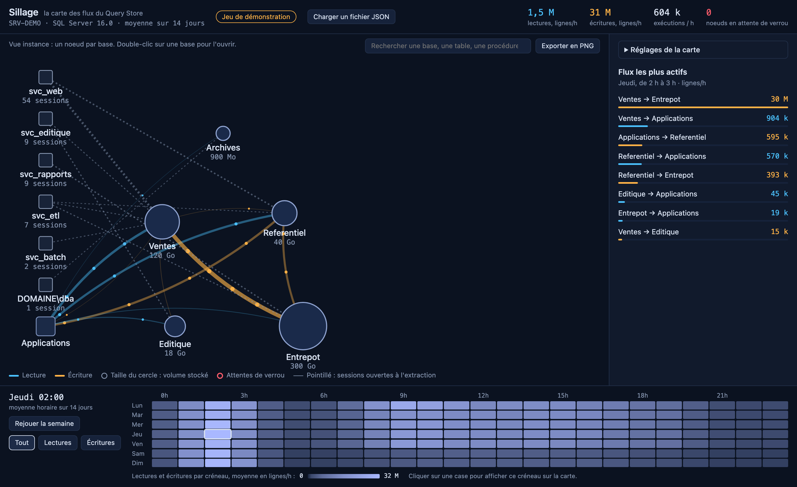

# Sillage

[Français](README.md) · **English**

**The Query Store data-flow map.**

Live demo: <https://cchopin.github.io/sillage/> (fictional demo dataset, no real data).



An interactive map of the data flows of a SQL Server instance, built from the Query Store alone. The principle: a SQL extraction produces a JSON file, and the HTML page reads that file and builds the map by itself. It can be replayed on any instance.

The project is written in French: the interface, the script parameters and the JSON field names are French. This page translates the documentation and gives the meaning of each name.

## Project status

What has been checked, and within which limits:

- **Full chain**: run end to end on test instances only, SQL Server 2022 (16.0), 2019 (15.0) and 2017 (14.0) on Linux in containers, with three small fictional databases and a few dozen executions. The launcher produced the file, and the map showed what was expected: cross-database flows, calling procedure, lock wait.
- **Extraction (`sql/extraction-query-store.sql`)**: on the 2022 instance, also run through `sqlcmd`, with `@Bases`, `@TopRequetes = 1`, `@TexteMax` at 0 and above 4000, and with both time zone fallbacks.
- **Launcher (`scripts/extraire.ps1`)**: run under PowerShell 7 on macOS, with SQL authentication.
- **Front end (`index.html`)**: checked on the demo dataset and on the file from the 2022 test instance.

What has not been checked:

- SQL Server 2016, Azure SQL, and SQL Server on Windows;
- a production instance: real volumes, extraction duration, complex plans, many databases, availability groups;
- a history of several days, and therefore a daylight saving change within the period;
- Windows PowerShell 5.1 and Windows authentication.

Feedback from real runs, errors included, is welcome.

## What is in the kit

| File | Role |
| --- | --- |
| `sql/extraction-query-store.sql` | Read-only extraction queries that return one JSON document |
| `scripts/extraire.ps1` | Runs the SQL script and writes the JSON to a file |
| `index.html` | The front end: opens in a browser, no server and nothing to install |
| `exemples/flux-exemple.json` | Demo dataset, in the format the front end expects |

## Requirements

- SQL Server 2016 or later, with Query Store enabled on the databases to map.
- `VIEW SERVER STATE` and `VIEW DATABASE STATE` permissions (or sysadmin).
- For the launcher: Windows PowerShell 5.1 or PowerShell 7, no module to install.
- Lock waits are only available from SQL Server 2017.
- A Query Store interval of 60 minutes or less. Above that, the hourly breakdown is approximate and the front end says so.

## Usage

1. Run the extraction from the repository root:

```powershell
.\scripts\extraire.ps1 -Serveur SRV-SQL01 -Sortie flux.json
```

With SQL authentication:

```powershell
.\scripts\extraire.ps1 -Serveur SRV-SQL01 -Utilisateur lecteur_qs -Sortie flux.json
```

`-Serveur` is the server, `-Sortie` the output file, `-Utilisateur` the SQL login (the password is prompted for).

2. Open `index.html` in a browser (or the live demo).
3. Click "Charger un fichier JSON" (load a JSON file), or drop `flux.json` onto the map.

Without PowerShell, the SQL script runs as is in SSMS or Azure Data Studio: it returns a single cell to copy into a `.json` file. SSMS truncates long cells, Azure Data Studio is more reliable for this copy. With `sqlcmd`, add `-y 0` so the cell is not truncated.

## Extraction settings

At the top of `sql/extraction-query-store.sql`:

| Variable | Default | Effect |
| --- | --- | --- |
| `@Jours` | 7 | Days of history analysed |
| `@TopRequetes` | 60 | Queries detailed per database, for each of three rankings (CPU, rows, logical reads). The others are grouped together |
| `@TopTables` | 200 | Tables described per database, largest first |
| `@TexteMax` | 300 | Length of the exported query text, 0 to export none |
| `@TailleMinMo` | 0 | Skips databases smaller than this size, in MB |
| `@Bases` | empty | Comma-separated list of databases, empty for all. Spaces around commas are ignored |

## Using the map

- **Search**: the field at the top of the map finds a database, a table or a procedure, opens the right view and selects the node.
- **PNG export**: "Exporter en PNG" saves the map as displayed, with the time slot and the measure as a caption. The image contains object names: see Privacy.
- **Timeline**: each cell is a weekday and hour slot. Its legend gives the colour scale. Click a cell to show that slot on the map, or "Rejouer la semaine" to play the week.
- Nodes can be dragged. Double-click a database to open its table view.

The "Réglages de la carte" (map settings) panel lets you:

- choose the flow measure: rows, executions, CPU time, duration, logical reads or logical writes;
- hide databases under a given size;
- untick databases one by one;
- cap the number of nodes shown (the least active are hidden);
- set the alert threshold for lock waits;
- hide queries that could not be attached to any table;
- show or hide the logins connected at extraction time.

Settings are remembered in the browser.

## How flows are inferred

- The most used execution plan of each selected query gives the list of tables it touches, including in other databases, and tells reads from writes.
- A read-only query creates a flow from each table read to "Applications".
- A write query creates a flow from each table read to the table written. With no source table, the flow starts from "Applications".
- A query stored in database A that touches a table in database B creates a flow between databases.
- Volumes are hourly averages, for each weekday and hour slot, in the server's local time. The total of each slot is divided by the number of times that slot occurs in the extracted period: a ten-day period holds two Mondays and a single Thursday.
- Local time follows daylight saving changes when the server's time zone can be determined (`CURRENT_TIMEZONE_ID()` from SQL Server 2022, a registry read before that). Otherwise, the offset in force at extraction time is applied to the whole history. The `meta.fuseau` field of the JSON says which case applied.

## Known limits

- The Query Store does not know who connects: all query flows end at the "Applications" node. As a complement, the extraction takes a snapshot of `sys.dm_exec_sessions`: the instance view shows one node per login, linked by a dotted line to the databases where it has open sessions. This snapshot carries no volume and only sees the sessions open at extraction time: a nightly job does not appear if the extraction runs during the day.
- A query that reads several tables assigns its whole volume to each of them: the flows of one query do not add up.
- Foreign key checks appear as source tables of a write.
- Temporary tables and system objects are ignored.
- Plans too deep to be converted to XML are attached to the "(autres)" (others) node of their database.
- Queries outside the selection are grouped under "(autres)", counted as reads.
- The Query Store also records the extraction's own queries. They carry the `/*sillage*/` marker and are left out of the map.
- On a secondary database of an availability group, the Query Store reflects the primary's activity, unless Query Store for secondary replicas is enabled (SQL Server 2022).

## Privacy

A real extraction must never be committed: the `.gitignore` excludes every `*.json` file except those in `exemples/`.

The JSON file contains database, table, procedure and login names, and query text excerpts that may include literal values. Set `@TexteMax` to 0 before sharing a file outside the team. An exported PNG shows the same names. The HTML page sends nothing and loads no external resource: the file is read locally by the browser, and the page works offline.

## JSON format

```json
{
  "meta":     { "serveur": "", "version": "", "extrait_le": "", "jours": 7, "top_requetes": 60, "fuseau": "" },
  "bases":    [ { "db": "", "mo": 0, "data_mo": 0, "log_mo": 0, "qs_min": 60, "qs_etat": "", "debut": "", "fin": "", "erreur": "" } ],
  "tables":   [ { "db": "", "t": "schema.table", "lignes": 0, "mo": 0 } ],
  "requetes": [ { "db": "", "q": 0, "txt": "", "obj": "schema.procedure" } ],
  "objets":   [ { "db": "", "q": 0, "odb": "", "ot": "schema.table", "w": 0 } ],
  "clients":  [ { "db": "", "login": "", "prog": "", "hotes": 0, "sessions": 0, "cpu_ms": 0, "lr": 0, "ecr": 0 } ],
  "horaire":  [ { "db": "", "q": 0, "s": 0, "e": 0, "r": 0, "c": 0, "d": 0, "lr": 0, "lw": 0, "lk": 0 } ]
}
```

Field names are French: `serveur` server, `extrait_le` extraction time, `jours` days, `fuseau` time zone, `mo` size in MB, `debut` and `fin` start and end of the history, `erreur` error, `lignes` rows, `requetes` queries, `objets` objects touched by a query, `hotes` client machines, `ecr` writes, `horaire` hourly figures.

In `horaire`, `s` is the slot (0 for Monday 0:00, 167 for Sunday 23:00). The other fields are totals over the period: `e` executions, `r` rows, `c` CPU in ms, `d` duration in ms, `lr` and `lw` logical reads and writes in pages, `lk` lock wait in ms. `q` is 0 for the group of queries outside the selection. In `objets`, `w` is 1 for a table written. `clients` and `meta.fuseau` are optional. `clients` holds one row per database and login, with the number of sessions open at extraction time.

## License

MIT, see [LICENSE](LICENSE).
